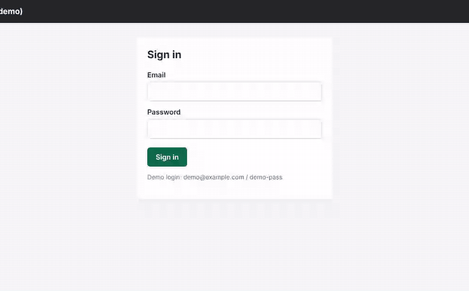
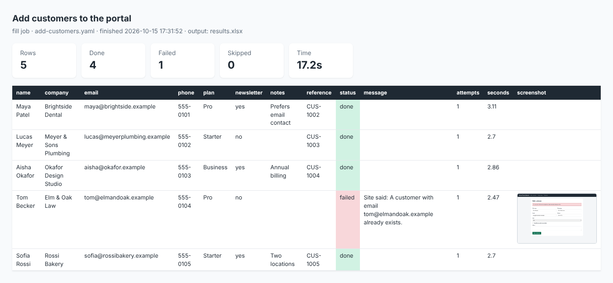

# Web Task Robot

**Stop copy-pasting into websites.** Web Task Robot reads rows from a CSV or Excel file and types them into any web form, or collects data from web pages into a spreadsheet. You describe the job in a short YAML file, and it runs in a real browser (Chromium, via [Playwright](https://playwright.dev/python/)) with retries, resume, screenshots and a report.

[](https://github.com/bikashnayak36331-pixel/web-task-robot/actions/workflows/ci.yml)




<sub>A real recording (Playwright video, typing slowed down so you can follow it) of the example job running against the built-in demo site.</sub>

## Why it's reliable

| Problem | What the robot does |
|---|---|
| The site is slow or flaky (timeouts, HTTP 5xx, 429) | Retries the row (default: up to 3 tries) with a pause in between |
| A form was sent but the site took too long to answer | **Doesn't** send it again (that could save the same record twice). The row is marked failed with a note to check the site. After a form is sent, the robot only retries if the site answers with an error page (HTTP 5xx or 429) |
| The site rejects the data ("email already exists", a browser validation error) | Records the site's own message and **doesn't** retry, since retrying wouldn't help. This also works on forms that save in the background with JavaScript |
| The job stops halfway (crash, laptop closed, Ctrl+C) | Ctrl+C finishes the current row and still writes the results. Run the job again: rows already done are skipped using a checkpoint |
| The same record appears twice in your file | The second copy is skipped and marked as a duplicate |
| "Did it really work?" | Optional success check per row, a screenshot of every failure, an Excel file with a status column, and an HTML report |
| Passwords | Kept in environment variables (`${PORTAL_PASSWORD}`), never in the job file or the results |

## Try it in one minute (offline)

```bash
pip install git+https://github.com/bikashnayak36331-pixel/web-task-robot
python -m playwright install chromium
webrobot demo
```

`webrobot demo` starts a small practice website on your computer, then runs both example jobs against it: [add-customers.yaml](src/web_task_robot/examples/add-customers.yaml) and [collect-products.yaml](src/web_task_robot/examples/collect-products.yaml). To show retries, some form posts fail on purpose. The output is real ([docs/demo-output.txt](docs/demo-output.txt)):

```
[  1/10] maya@brightside.example: attempt 1 failed (The site returned HTTP 503 for http://127.0.0.1:PORT/customers/new); retrying
[  1/10] maya@brightside.example: done in 0.96s
[  2/10] lucas@meyerplumbing.example: done in 0.2s
[  3/10] aisha@okafor.example: done in 0.24s
[  4/10] tom@elmandoak.example: failed (Site said: A customer with email tom@elmandoak.example already exists.) in 0.23s
...
[  9/10] maya@brightside.example: skipped (duplicate of row 1)
[ 10/10] elena@petrova.example: done in 0.2s
Add customers to the portal: 7 done, 2 failed, 1 skipped in 6.6s
page 1: 8 items (8 total)
...
Collect products: 30 done, 0 failed, 0 skipped in 2.8s
```

Every run writes a results spreadsheet and this report:



## Write your own job

Start by copying the examples and running them yourself against the practice site.

1. In one terminal, start the practice site and leave it running:

   ```bash
   webrobot demo-site                # http://127.0.0.1:8765, login demo@example.com / demo-pass
   ```

2. In a second terminal, copy the examples and tell them where the site is and how to log in:

   ```bash
   webrobot examples my-jobs         # copies the example jobs and CSV into ./my-jobs to edit
   export DEMO_URL=http://127.0.0.1:8765 PORTAL_USER=demo@example.com PORTAL_PASSWORD=demo-pass
   ```

   On Windows PowerShell, set the variables like this instead:

   ```powershell
   $env:DEMO_URL="http://127.0.0.1:8765"; $env:PORTAL_USER="demo@example.com"; $env:PORTAL_PASSWORD="demo-pass"
   ```

3. Check the job, try it on a few rows, then run it all:

   ```bash
   webrobot check my-jobs/add-customers.yaml                    # checks the file, the CSV columns and the variables
   webrobot run my-jobs/add-customers.yaml --limit 3 --headed   # try 3 rows with the browser visible
   webrobot run my-jobs/add-customers.yaml                      # then the whole file
   ```

For your own site, change the URLs and selectors in the YAML file, and set your own variables for the login.

**Fill a form for every row** (`{column}` comes from the row; `${VAR}` comes from the environment):

```yaml
name: Add customers to the portal
type: fill
input: customers.csv          # or .xlsx (add  sheet: Leads  to pick a sheet)
key: email                    # identifies a row, for resume and duplicate checks

login:
  url: https://portal.example.com/login
  steps:
    - fill: { selector: "#email", value: "${PORTAL_USER}" }
    - fill: { selector: "#password", value: "${PORTAL_PASSWORD}" }
    - click: "button[type=submit]"

steps:
  - goto: https://portal.example.com/customers/new
  - fill: { selector: "#name", value: "{name}" }
  - select: { selector: "#plan", value: "{plan}" }
  - check: { selector: "#newsletter", when: "{newsletter}" }   # ticks the box if the cell says yes/true/1
  - click: "#save"
  - extract: { selector: ".alert-success .ref", as: reference } # adds a 'reference' column to the results

success: ".alert-success"     # a row only counts as done if this appears
error: ".alert-error"         # if this appears, its text is recorded and the row is not retried
options: { retries: 2, delay_ms: 250, screenshots: failure }
```

**Collect data across pages:**

```yaml
name: Collect products
type: extract
start_url: https://shop.example.com/products
item: ".product-card"
fields:
  sku: { attr: data-sku }       # an attribute of the item itself
  name: ".name"
  price: { selector: ".price", parse: number }
  url: { selector: "a", attr: href, absolute: true }
  # whole: "."                  # "." is the item itself (its text)
next_page: "a.next"             # a link, or a button that loads the next items with JavaScript
max_pages: 20
output: products.xlsx          # .csv, .xlsx or .json
```

If a page has no items, the robot says so and stops. If a later page fails to load, the rows collected so far are still saved.

<details><summary><b>All step types and options</b></summary>

| Step | Example | Notes |
|---|---|---|
| `goto` | `- goto: https://site/new` | |
| `fill` | `- fill: { selector: "#name", value: "{name}" }` | |
| `type` | `- type: { selector: "#search", value: "{q}" }` | Types key by key, for fields that react to typing |
| `select` | `- select: { selector: "#plan", value: "{plan}" }` | Matches the option's value or its label |
| `check` / `uncheck` | `- check: { selector: "#terms", when: "{agree}" }` | Without `when`, it always ticks. Works for radio buttons too: `- check: "#size-{size}"` |
| `click` | `- click: "#save"` | Then checks for server errors, the `error` selector and browser validation |
| `press` | `- press: { selector: "#q", key: Enter }` | Key names such as `Enter`, `Tab`, `Escape`, `Control+a` (any capitalisation) |
| `upload` | `- upload: { selector: "#file", file: "{attachment}" }` | A file path from the row or the job file. A relative path is relative to the job file |
| `wait_for` | `- wait_for: ".results"` | Or `{ selector: ..., state: hidden }` |
| `wait_ms` | `- wait_ms: 500` | |
| `extract` | `- extract: { selector: ".ref", as: reference }` | Use `attr:` to read an attribute |
| `assert_text` | `- assert_text: { selector: "h1", contains: "{name}" }` | Fails the row (no retry) if the text is missing |
| `screenshot` | `- screenshot: "{email}-before-save"` | |

| Option | Default | Meaning |
|---|---|---|
| `retries` | 2 | Extra tries for a row after timeouts or server errors (once a form is sent, only after server errors) |
| `retry_delay_ms` | 1000 | Pause before a retry |
| `delay_ms` | 250 | Pause between rows (be polite to the site) |
| `timeout_ms` | 15000 | How long to wait for an element or a page |
| `screenshots` | `failure` | `failure`, `each` or `never` |
| `headless` | true | `--headed` on the command line shows the browser |
| `typing_delay_ms` | 0 | Type key by key with this delay |
| `slow_mo_ms` | 0 | Pause between every browser action (for watching or recording) |
| `dialogs` | `dismiss` | What to do with alert, "Are you sure?" and prompt boxes: `dismiss` (Cancel) or `accept` (OK) |

Input files: `.csv` (comma, semicolon or tab separated; UTF-8 or the older Windows encoding) or `.xlsx`. Excel dates are typed as `2026-10-20`, the format date fields expect. In the results Excel file, text from websites is always stored as text, never as a formula.

Command-line options for `webrobot run`:

- `--out DIR`: results folder (default `out`).
- `--limit N`: only the first N rows.
- `--fresh`: ignore the checkpoint.
- `--headed`: show the browser.
- `--slow-mo MS`: pause between browser actions.
- `--video DIR`: record a video of the run.

Exit codes: 0 when every row worked, 1 when some rows failed, 2 for a problem in the job file, and 130 after Ctrl+C.
</details>

## Tested end to end

Version 1.1.0 came out of a full test on 16 Oct 2026, which found 25 problems, all fixed (see the [changelog](CHANGELOG.md)). The test covered:

- **A clean install** from GitHub on a new Linux machine, following this README.
- **Every command, step and option**, against the practice site and local test pages: a slow server, JavaScript forms and lists, Excel dates, uploads, confirm boxes, Ctrl+C and odd files.
- **Public practice websites:**
  - [Books to Scrape](https://books.toscrape.com/): 60 books over 3 pages. Titles, prices and links match the site.
  - [Quotes to Scrape](https://quotes.toscrape.com/), including its JavaScript and delayed-loading versions.
  - [The Internet](https://the-internet.herokuapp.com/): dropdowns, checkboxes, key presses, content that loads later, confirm boxes, and real HTTP 503 errors (retried, then reported).
  - The [Selenium test form](https://www.selenium.dev/selenium/web/web-form.html).
  - The [httpbin](https://httpbin.org/forms/post) order form: the server received every field exactly as typed.

GitHub Actions runs the tests on Linux (Python 3.10, 3.12 and 3.13), Windows and macOS.

## Use it responsibly

Only automate sites you own or have permission to use, and follow their terms. Keep `delay_ms` reasonable. The robot doesn't solve CAPTCHAs or get around logins or bot protection. If a site offers an API, that's usually the better way in.

## Development

```bash
git clone https://github.com/bikashnayak36331-pixel/web-task-robot && cd web-task-robot
pip install -e ".[dev]" && python -m playwright install chromium
pytest                          # 54 tests, including end-to-end runs in headless Chromium against local test sites
ruff check . && ruff format --check .
python scripts/record_demo.py   # re-record docs/images/demo.gif and report.png (needs ffmpeg)
```

The code is in `src/web_task_robot/`:

- `config.py`: job files and validation;
- `runner.py`: the browser;
- `tables.py`: CSV and Excel;
- `report.py`: the HTML report;
- `demo_site.py`: the practice site;
- `cli.py`: the command line.

## Need a robot for your website?

Common jobs I can build:

- uploading orders or leads into a portal;
- checking prices and stock;
- downloading reports;
- moving records between two systems that have no integration;
- testing your own web app.

Open an issue or contact me through my GitHub profile.

## Credits

Built by Bikash Nayak, using Claude (Anthropic) as a coding assistant. Released under the [MIT License](LICENSE).
